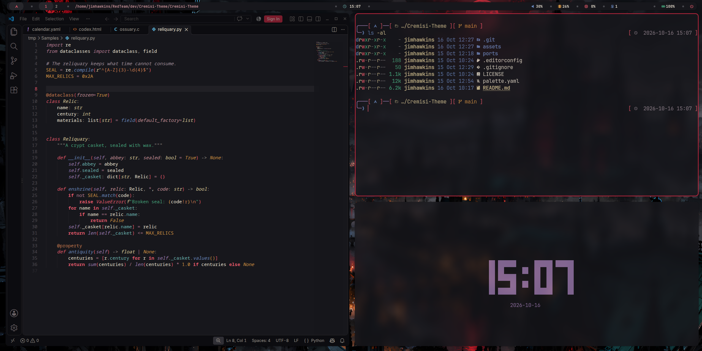
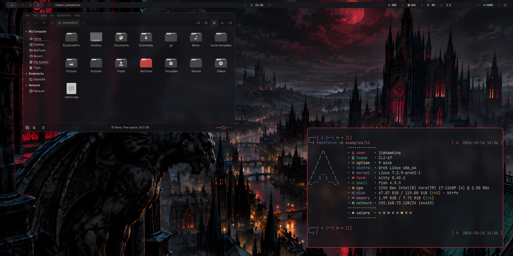

# Cremisi i3 Dotfiles

> *Ex umbra in lucem.* — A reliquary of configurations, bound in crypt stone and blood.

Gothic and arcane: an i3 desktop built around the **Cremisi Obsidian** colour scheme — sixteen materials drawn from bone, stone, crimson and candlewax.

Full colour scheme and editor ports: [vari-sh.github.io/cremisi](https://vari-sh.github.io/cremisi/)

---

## Screenshots





---

## The Palette

| Name | Hex | Role |
|---|---|---|
| `ground` | `#17171c` | Crypt stone — background |
| `ink` | `#e9e1d1` | Bone — foreground text |
| `crimson` | `#c42740` | The accent. The only one. |
| `blood` | `#e2586a` | Parentheses, errors, cursor |
| `lapis` | `#6886bb` | Functions, prompt |
| `amber` | `#cf9142` | Git, durations, warnings |
| `malachite` | `#44a078` | Success, Python |
| `verdigris` | `#6bb3b0` | Time |
| `amethyst` | `#9c7bb0` | OS, user |
| `tallow` | `#dccb9a` | Path, types |
| `incense` | `#9e8d99` | Comments, muted text |
| `wine` | `#b27a90` | Hostname |
| `petal` | `#c58f96` | Window title |
| `sealwax` | `#c6784c` | Warmth |
| `iron` | `#9a948c` | Neutral punctuation |

---

## Contents

All configurations live under `Dotfiles/`:

```
i3/               Window manager — Cremisi Obsidian theming, keybindings, gaps
polybar/          Status bar — IP, CPU, RAM, battery, volume, clock
kitty/            Terminal emulator — colours and font
rofi/             Launcher and power menu
dunst/            Notification daemon
picom/            Compositor — blur, shadows, rounded corners
starship.toml     Shell prompt
betterlockscreen/ Lock screen
yazi/             File manager — Cremisi Obsidian flavour
```

The GTK theme lives in `GTK-Theme/Cremisi-Obsidian/` — see [GTK Theme](#gtk-theme).

---

## Dependencies

- **i3** — tiling window manager
- **polybar** — status bar
- **kitty** — terminal
- **rofi** — application launcher
- **dunst** — notifications
- **picom** — compositor
- **starship** — shell prompt
- **betterlockscreen** — lock screen
- **yazi** — file manager
- **JetBrainsMono Nerd Font** — the sole typeface
- **nitrogen** — wallpaper
- **flameshot** — screenshots
- **greenclip** — clipboard manager
- **jq**, **curl** — required by the polybar IP monitor script

> The polybar IP monitor (`polybar/scripts/ip_monitor.sh`) asks `ip-api.com` over plain HTTP for your public IP, so that service sees your address. Drop `public-ip` from `modules-right` if you would rather not.

---

## Rite of Entry

```bash
git clone https://github.com/vari-sh/Cremisi-i3-dotfile
cd Cremisi-i3-dotfile/Dotfiles

# Copy into ~/.config/
cp -r i3 polybar kitty rofi dunst picom yazi ~/.config/
cp starship.toml ~/.config/
cp betterlockscreen/betterlockscreenrc ~/.config/betterlockscreen/

# Reload i3
i3-msg restart
```

Or use `stow` if you prefer symlinks:

```bash
stow --target ~/.config .
```

---

## GTK Theme

**Cremisi Obsidian** for GTK 3 and GTK 4: crypt-stone surfaces, bone text, blood accents, and the diamond as the recurring sigil.

- Radio buttons, scale sliders and window buttons are diamonds; sliders with marks become spearheads pointing at their marks.
- Check marks and dashes are blades with pointed ends; checkboxes have sharp corners.
- Maximize is a pointed (lancet) arch; minimize is a line bound by a small diamond.

### Installation

```bash
cp -r GTK-Theme/Cremisi-Obsidian ~/.themes/
```

Then select it, e.g. in `~/.config/gtk-3.0/settings.ini` and `~/.config/gtk-4.0/settings.ini`:

```ini
[Settings]
gtk-theme-name=Cremisi-Obsidian
gtk-application-prefer-dark-theme=1
```

libadwaita applications ignore GTK themes; to theme them too, link the GTK 4 files into your config:

```bash
mkdir -p ~/.config/gtk-4.0
ln -sf ~/.themes/Cremisi-Obsidian/gtk-4.0/{gtk.css,gtk-dark.css,assets} ~/.config/gtk-4.0/
```

The theme suggests the **Tela** icon theme (`Tela-circle-black-dark` in `index.theme`).

### Regenerating the assets

The SVG assets and the diamond-shape CSS rules are generated by the scripts in `src/` (Python 3, no dependencies):

```bash
cd GTK-Theme/Cremisi-Obsidian
python3 src/gen_assets.py gtk-3.0/assets gtk-4.0/assets
# patch_css.py applies the diamond rules to a freshly compiled stylesheet;
# it skips the steps that are already applied
python3 src/patch_css.py 3 gtk-3.0/gtk.css gtk-3.0/gtk-dark.css
python3 src/patch_css.py 4 gtk-4.0/gtk.css gtk-4.0/gtk-dark.css
```

### Credits

The stylesheet is derived from [Colloid](https://github.com/vinceliuice/Colloid-gtk-theme) by vinceliuice, by way of [Catppuccin GTK](https://github.com/catppuccin/gtk), both licensed under GPL-3.0. Changes from upstream: the palette was replaced with Cremisi Obsidian, every SVG asset was redrawn, and the CSS was patched for diamond-shaped controls.

---

## License

- Dotfiles: [MIT](LICENSE) © vari.sh
- GTK theme (`GTK-Theme/`): [GPL-3.0](GTK-Theme/Cremisi-Obsidian/LICENSE), as a derivative of Colloid / Catppuccin GTK
- yazi flavor: MIT, derived from the yazi-rs Catppuccin Mocha flavor (see its [LICENSE](Dotfiles/yazi/flavors/cremisi-obsidian.yazi/LICENSE))
